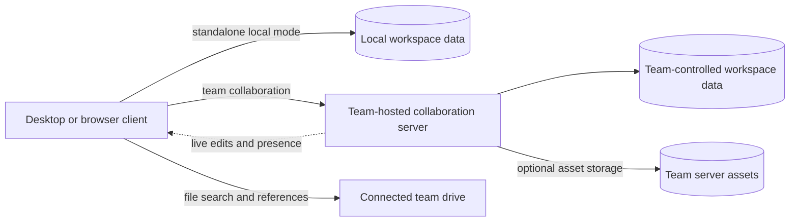
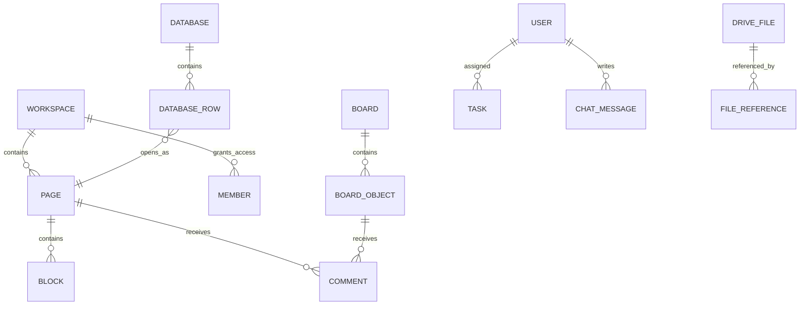

# Architect product direction

Architect is a private, team-owned workspace tool for documents, structured data, visual work, and team coordination. It should combine the flexibility of a document workspace with the shared presence and communication tools of a team app, while leaving hosting and storage under the team's control.

This document describes the intended product, not a claim that these capabilities already exist. See [`../Completed/ImplementedFeatures.md`](../Completed/ImplementedFeatures.md) for the current implementation and [`../WorkInProgress/TODO.md`](../WorkInProgress/TODO.md) for prioritized work.

## Product principles

1. **The team controls where it runs and where its data lives.** Multi-user live editing needs a collaboration server, but that server should be team-hosted or otherwise explicitly chosen by the team; Architect must not require a global Architect-hosted website or cloud service.
2. **One purchase, no subscription plans.** The intended commercial model is a single payment for the tool for a team. Do not design subscription tiers or plan-gated features. License delivery, upgrades, and any limits still need a product decision.
3. **One workspace for work.** Documents, databases, visual boards, tasks, discussions, calendar events, files, and permissions should be connected rather than scattered across separate products.
4. **Fast, direct editing.** Text pages should have a modern, keyboard-friendly toolbar and editing experience inspired by Obsidian, with clear controls and local-first responsiveness.
5. **Reference files instead of copying them.** Drive integration should let users find and attach references to existing files. Upload is available when needed, with clear ownership and storage behavior.
6. **People stay in control.** Remove AI chat surfaces and the marketplace from the product. Avoid AI-generated content flows and third-party app marketplace dependencies in the core interface.

## Hosting, data, and deployment

The user or team chooses between workspace coordination modes, with asset storage selected separately (defaulting to **Local only** coordination with **Local storage**):

- **Local only (default):** run Architect on a computer, keeping workspace data on that device (app-owned desktop data directory or browser profile). Works offline without an account or server.
- **Cloud-drive file sync (solo cross-device + view-only mirrors, NOT co-op):** an optional file-sync mode for **local solo usage across multiple devices** (like Joplin or Obsidian sync)—not a multi-user co-op editing mode. Also supports **view-only sharing** where viewers' clients auto-sync *from* the shared cloud source (one-way pull only, **never** writing back to the source, with the editor strictly read-only) configurable either **on startup only** or every **`X` minutes**.
- **Team collaboration server (required for live co-working):** connect to a self-hosted or team-hosted collaboration server (including one hosted on the team's own domain). The server authenticates accounts/profiles, enforces Discord-style role permissions, routes/persists live edits via WebSockets, runs databases/search/chat/notifications, and optionally publishes sites. A future Architect-hosted server could be optional, but must not be the only way to collaborate.
- **Asset storage:**
  - **In local mode:** choose between a **local folder/storage** (default) or a connected **cloud drive**.
  - **In team collaboration mode:** the workspace **Admin** chooses whether assets are managed on an **external online drive** or **on the server** itself. A drive connection does not imply that Architect owns or copies all drive content.

True real-time co-working requires a shared coordination server to authenticate members, enforce access rules, persist revisions, broadcast presence/edits, and resolve concurrent changes. Architect provides a local-first desktop/web experience by default and adds a self-hostable backend server component when teams enable live collaboration.

Deployment requirements:

- No mandatory Architect-operated website, identity service, file store, or collaboration cloud.
- A server is required for shared live editing; a self-hostable team server is the first-class route. Local-only mode remains independent and does not pretend to sync.
- Make the active mode, data location, and connected drives visible in settings.
- Design local-only use to work without an account on an Architect service.
- Team collaboration mode needs authentication, authorization, encrypted transport, backup/restore, and an upgrade path.
- Define how offline edits, server availability, conflicts, and local caches behave before implementing synchronization.
- Keep workspace content exportable in documented formats and provide a recovery path for server or local data.
- Treat drive integration as provider adapters with least-privilege access; preserve file IDs/URLs and provider metadata rather than silently duplicating files.

### Initial data contract

- **Local mode:** no sign-in to an Architect service. The current prototype stores the workspace in the browser/Electron profile; the new settings flow makes that location visible and supports portable JSON backup/restore. Treat this as prototype storage behind a future storage adapter, not the final desktop database design.
- **Portable format:** versioned JSON workspace backup with workspace metadata, stable content IDs, user records, page/block data, and references to locally uploaded assets. Import must validate the version and preserve the existing workspace if validation or storage fails.
- **Desktop target:** move the source of truth behind a storage adapter and into an app-owned local data directory. Keep export format independent of the internal database so local storage can evolve without breaking backups.
- **Collaboration server:** a workspace connects directly to its administrator-configured server URL. The server owns the authoritative workspace database, revisions, member sessions, and file metadata. The first API proposal is versioned JSON over HTTPS for reads/writes plus WebSocket events for live edits and presence; no requests route through an Architect-operated service.
- **Accounts vs. per-workspace profiles:** local-only mode uses a local profile without sign-in. In team mode, users create/own one core **Account**; workspace Admins provision **Workspace Profiles** inside a workspace (often tied to **company email**) and link them to users' Accounts. One Account can belong to **multiple workspaces at once**, with a distinct **Profile** per workspace (separate display name, profile picture, company email, custom roles, and permissions). No global Architect SaaS account is required.
- **Discord-style custom roles & server-enforced permissions:** admins can **create custom roles, edit role permissions/display colors/order, and remove roles** on the Admin Dashboard. **Pages (as well as databases, boards, channels, and asset collections)** can be assigned **per-role overrides** (like Discord channels) controlling who has access, who can edit, write comments, or manage files—enforced on the backend for every read, write, search query, asset stream, and WebSocket event.
- **Offline, solo cloud sync, and conflicts:** local-only mode works offline by definition. Optional solo cloud-drive sync tracks revisions and lets view-only clients pull from a shared source every `X` minutes or on startup without write access. In team server mode, the server coordinates live CRDT/OT edits and stores revisions; offline edits queue with their base revision and reconcile on reconnect, surfacing non-trivial conflicts instead of silently overwriting.
- **Files & asset registry:** the backend maintains an asset metadata registry (`id`, `workspaceId`, `provider`, `externalFileId`, `canonicalUrl`, `mimeType`, `sizeBytes`, `dimensions`, `tags`, `checksum`, `accessState`), token vault for connected drives, and upload/proxy endpoints. Large binary bytes live in the connected drive or configured server object/file store—never embedded inside workspace JSON.
- **Recovery & trash:** export a portable backup before destructive migration/restore. Soft-deleted pages, rows, blocks, and channels enter a restorable Trash with configurable retention, alongside page version snapshots and scheduled server backups.

## Page and workspace content types

Architect should support multiple purpose-built content types under one workspace. Each type has an appropriate editor, toolbar, permissions, and linkable identity.

| Type | Intended use | Core interactions |
| --- | --- | --- |
| Text page | Notes, specs, and long-form writing | Rich text, Markdown shortcuts, backlinks, embeds, comments, attachments |
| Database | Structured records and workflows | Properties, rows, views, filters, sorts, relations, automations |
| Board | Spatial planning, diagrams, and workshops (Miro-like) | Infinite canvas, movable objects, connectors, frames, comments, zoom |
| Task view | Personal and team work | Task status, assignee, due date, priority, project, list/board/calendar views |
| Calendar | Team schedule and time planning | Events, availability, task dates, participant permissions |
| Chat | Real-time team discussion | Direct chats, topic channels, groups, replies, mentions, attachments |
| Dashboard | User or team landing page | Configurable widgets for tasks, chats, calendar, time, and quick links |

Pages and records should have stable IDs, titles, owners, timestamps, permissions, and links. Database rows can open as pages and can be linked from text, tasks, boards, and chats. Board objects and comments should have stable IDs as well. The content model and migrations must support adding a new type without breaking existing pages.

### Shared model and permissions

- Give every workspace, member, page, block, database, schema property, row, board, board object, task, event, channel, message, comment, file reference, and automation a stable UUID. Keep display names separate from identity.
- Common metadata: `workspaceId`, `createdAt`, `updatedAt`, `createdBy`, `updatedBy`, and a monotonically increasing `revision`. Records that can be archived or deleted should have explicit lifecycle state instead of being silently discarded.
- A database row has its own ID and a linked page ID. Its values are keyed by shared schema property IDs. A schema migration must preserve unknown values and provide a reversible backup before changing stored data.
- Use versioned, ordered migrations (`fromVersion`, `toVersion`) for local data and server data. Migrations must be idempotent, validate before commit, and retain a restorable pre-migration backup.
- Workspace roles begin with **owner**, **admin**, **member**, and **guest**. Check access at the server boundary and in the UI. Page/database/board/channel permissions can narrow inherited workspace access; explicit grants and denies should be visible and auditable.
- Dashboard widgets, search, inbox, chat previews, and notifications must apply the same access checks as opening the underlying record. Never leak titles or snippets for inaccessible records.
- Keep an audit event for membership, role, permission, drive connection, and administrator announcement changes. Do not expose private direct messages or time details to admins unless the workspace policy explicitly grants that access.

## Text page editor and toolbar

Non-database pages should have a modern toolbar inspired by Obsidian. It should remain focused on writing and make common formatting available without requiring slash commands.

- Formatting: paragraph, heading levels, bold, italic, underline, strikethrough, inline code, code block, highlight, clear formatting.
- Structure: bulleted and numbered lists, checklists, quotes, callouts, dividers, tables, columns, collapsible sections, links, page references, and embeds.
- Insertion: image/file reference, board/database/task reference, date, and comment anchor.
- Editing: undo/redo, keyboard shortcuts, Markdown typing shortcuts, selection-aware actions, paste conversion, and accessible toolbar navigation.
- Presentation: compact and readable controls, visible active formatting, contextual selection toolbar, and configurable toolbar placement/visibility.
- Slide presentation mode (backlog): "Present from here" entry (`Ctrl+Alt+P`) from block handle actions to present page sections cleanly as slides with keyboard navigation and exit controls.
- Markdown: common Markdown input shortcuts and copy/export behavior should be predictable. Store semantic document nodes so formatting survives edits and export.

The toolbar is for text pages. Database and board pages should show controls that fit their own content type rather than forcing the text toolbar everywhere.

## Dashboards, tasks, calendar, and time

Separate **User Dashboard** and **Admin Dashboard** views keep personal workflow focused while restricting administrative settings to authorized roles:

- **User Dashboard:** personalized workspace home for every member with configurable permission-aware widgets (my tasks, recent chats, calendar agenda, personal time tracker) saved independently per user.
- **Admin Dashboard:** essentially workspace settings accessible **only to users holding roles with admin/manage permissions**, structured cleanly as compact cards opening focused popup managers (`Member Manager`, `Time Tracking`, `Role Manager`, `Asset Library` & `Files & save locations`, plus `Messages & Notifications` composer & analytics). Houses workspace coordination/storage mode, **Account-linked Workspace Profile provisioning** (email, username, and invite links mapping a global Account to a per-workspace Profile), **Discord-style custom role creation/editing/deletion**, **Workspace Customization** (`Customization` tab controlling UI button/sidebar icons, canvas/workspace backgrounds, selectable color themes, and default workspace fonts), **Plugin browser** (`Plugin browser` tab inside `#settings-dialog`), **Scheduled & Interactive Notifications** (future send queue, default `Confirm read` / `Read later` user buttons, custom trackable buttons, and per-message read/click analytics), drive/server storage selection, custom-domain publishing verification, module toggles, retention, backups, and audit logs.
- **Task overview & Split Scratchpad + Tasks:** assigned to me, due soon, overdue, status, priority, and project filters; quick status and due-date edits; Tasks Completed filter styled as a Trash bin auto-clearing ~72 hours after completion; plus future redesign of **Scratchpad Promote-to-Page/Database** so promoted notes reliably save as linked subpages under their chosen parent page or database records.
- **Chats:** recent direct chats, topic channels, groups, unread counts, and mentions.
- **Calendar:** full month, week, day, and year zoom views + multi-year navigation; per-entry & global role permissions (**read / edit / write**, defaulting to creator + invited attendees + authorized roles); filtering by department and user; **Calendly-style shareable scheduling links**, **Block my day**, **multi-person overlapping availability finder**, **required vs guest invitees**, **location + agenda topics + pre-read documents**, and a **+30 min post-meeting attendance/time-log confirmation pop-up** wired into Time Tracking.
- **Time tracker (Kimai-style):** auto-starts on app launch and stays alive in background/tray on desktop window close (prompting confirmation only on full quit), with manual start/stop, free-text description, a shared **department** field synchronized across Time Tracking, Team Database, and Taskboard, and both **from–to** range and **hours + minutes** entry. Define privacy and who can view team time before implementation.

Permissions should follow the underlying records. A dashboard must not expose a task, chat, or calendar item to a user who cannot access its source. **`No one has access to this`** locks a page/subtree strictly to the workspace owner while still preserving full owner access.

## Asset management and drive references

Provide a central Asset Management System for files users can access. Defaults to **local folder/storage** in local mode, while letting local users connect a cloud drive and letting **co-working Admins choose** between an **external online drive** or **server-managed asset storage**.

- **Rich asset catalog & metadata:** track structured `metadata` (dimensions, duration, custom fields), `fileType` (MIME/extension), **`category`** (e.g., `music`, `sfx`, `3d model`, `concept`, `illustration`, `video`, `document`, `image`, `other`), **`creator`** (distinct from uploader—**Admins can reassign the creator**), and **`tags`**, alongside provider identity and `storageMode` (`local` | `server` | `drive-reference`).
- **Searchable, interactive Asset Library:** search and filter by name, `fileType`, `category`, `creator`, `tags`, provider, folder, and metadata, returning a browsable library where assets can be **inspected and played directly inside the search/library UI**:
  - **Audio (`music` / `sfx`):** inline waveform/bar player with play/pause and a **clickable, scrubbable timeline**.
  - **Images (`concept` / `illustration` / photos):** crisp gallery preview + **fullscreen high-quality lightbox** (opened on double-click or context menu).
  - **Video:** inline video player with timeline scrubbing and fullscreen option.
  - **3D models, PDFs & other files:** metadata preview cards and original file downloads.
- **Attach cloud/server references:** attach a reference to a page, database row, board object, task, or chat, preserving provider identity and opening the original file.
- **Tiered previews vs. full-file downloads:** inline file and image attachments store and render lightweight/resized previews while referencing the canonical file on the connected cloud drive, server store, or local folder. Explicit downloads (`Download` / original file open) stream the full-sized original file, rather than loading full binaries on every page view.
- **Upload, tag & creator management:** upload files explicitly to local storage, server storage, or a connected drive; edit tags/categories, reassign `creator` (admin), rename when allowed, handle deleted/moved file states, and refresh metadata without copying entire drives unnecessarily.
- Keep drive credentials secure and request only scopes needed for selected operations.

The asset manager must distinguish a **drive reference** from a **local/server-managed upload**. The UI should state where an upload is stored and who can access it.

## Image annotations and comments

Users should be able to mark a region of an image and attach a comment to that exact location, similar to Google Drive image comments.

- Create an image annotation by selecting or drawing a region, then writing a threaded comment.
- Show annotation markers and comment threads on the image; selecting a comment highlights its region and vice versa.
- Support replies, resolve/reopen, mentions, timestamps, and permission checks.
- Keep annotation coordinates stable as the image is zoomed or resized; define how they behave if the underlying image changes.
- Store annotations against the referenced file identity and version where available. For unsupported drive providers, offer a clear local annotation fallback without implying the source file was modified.
- Provide keyboard-accessible alternatives to drawing a region.

## Inbox

Replace a basic notification list with a configurable inbox that helps users triage work.

- Combine mentions, page comments, task assignments/updates, chat activity, approvals, and administrator announcements.
- Filter by source, workspace, unread/read, assigned to me, and date; search and sort the inbox.
- Allow mark read/unread, archive, snooze, mute source/thread, and bulk actions where permissions allow.
- Configure notification categories and delivery preferences without hiding security-critical messages.
- Group related activity into threads and link directly to the relevant page, block, image region, database row, task, or chat message.
- Keep global administrator announcements distinct and clearly labeled; users should be able to tell who sent them and whether action is required.

## Chat, groups, notifications, administration, and permissions

Provide team communication inspired by Discord while keeping conversation attached to workspace work.

- Direct messages, topic-based channels, and private groups persisted on the backend and delivered in real time over WebSockets.
- Threads/replies, mentions, reactions, attachments, message search, unread read-cursors, and notification controls.
- Link chat messages to pages, tasks, database records, boards, calendar events, and files.
- Backend notification & Inbox service aggregating `@mentions`, page/image comments, task assignments, automation alerts, chat replies, and admin announcements, with configurable delivery (in-app Inbox, desktop/Web Push, optional email/webhook dispatch).
- Administrators can send important global announcements to the whole workspace; support acknowledgment or required-action state where appropriate.
- **Admin Dashboard (role-gated per workspace):** workspace settings accessible only to users with administrative roles. Provision/invite workspace profiles (tied to company mail, linked to user Accounts), **create/edit/delete Discord-style custom roles**, set **per-page/per-channel role permission overrides** (access, edit, comment, manage assets), choose asset storage backend (**external online drive vs. server storage**), configure solo cloud-sync / read-only mirror policies, verify custom publishing domains, view server health/queues/backups, set retention policies, and inspect audit history.
- Role & permission inheritance: roles grant baseline workspace capabilities and inherit down **Workspace → Page / Database / Board / Channel / Category**, with explicit Discord-style **per-page role overrides** (view, edit, comment, upload) enforced on the server with visible sharing state and an audit log for sensitive changes.
- Separate administrator-wide announcements from ordinary global chat. Define moderation, retention, search visibility, and who may create channels/groups.

## Site publishing (domain-gated)

Workspaces can publish selected pages or page trees to the public web **only when the workspace has a connected and verified custom domain**.

- Domain verification on the Admin Dashboard (DNS CNAME/TXT check and HTTPS/TLS termination) before enabling public publishing controls.
- Explicit per-page publish/unpublish toggle, custom URL slug, snapshot publishing (`draft` vs live published snapshot so in-progress edits are not leaked), SEO/OpenGraph metadata, and search-engine indexing toggle.
- Serve published pages read-only with strict isolation: never expose private workspace pages, draft blocks, internal member lists, chat, or unauthorized drive/server assets on public routes.

## Supporting backend infrastructure

To keep all workspace surfaces consistent, fast, and safe, the backend also needs:

- **Permission-aware full-text search index:** indexes pages, blocks, database rows, asset metadata, and chat messages while strictly filtering results by the caller's backend permissions.
- **Background job queue & scheduler:** handles Drive metadata/sync refreshes, notification dispatch, scheduled backups, thumbnail generation, static/published site builds, and automation executions with retry and dead-letter tracking.
- **Trash, version history, and audit trail:** recoverable soft-delete (`Trash`) with retention windows, historical page/block revision snapshots, and immutable audit logs for security/admin events.
- **API security & observability:** session/token management, CSRF/XSS sanitization, upload size/type enforcement, rate limiting, and `/health` + storage/queue telemetry in the Admin Dashboard.
- **App updates & version compatibility:** publish signed Electron desktop builds + `latest*.yml` update manifests via **GitHub Releases** (`electron-builder` + `electron-updater`) with an optional **team-server update mirror (`generic` feed)** for private/self-hosted deployments. The backend exposes its version and `minClientVersion` (via HTTP header / WebSocket handshake) so browser clients prompt to reload and Electron clients show an in-app **Update available (Install & Restart / Later)** prompt without breaking protocol compatibility against self-hosted servers.

## Databases, buttons, and automations

Databases should be shared collections with multiple views, not unrelated properties attached to individual pages.

- Shared schemas, typed properties, records that open as pages, relations, rollups, and reusable views.
- Table, list, board, calendar, and gallery views with filters, sorting, grouping, visible-property controls, and saved view settings.
- Buttons should support named actions such as creating a record/page, changing a property, assigning a person, setting a date, adding a comment, or opening a link.
- Automation triggers may include record creation/change, property condition, schedule, or an explicit button action.
- Automation actions must be permission-checked, previewable, traceable, and safe to retry. Show run history, failures, and the actor/automation responsible.
- Start with deterministic actions; define loops, duplicate triggers, rate limits, and rollback behavior before exposing automation chains.

## Explicitly excluded from the product

- AI chat or AI assistant surfaces.
- An app or integration marketplace.
- Subscription plans, tiered plans, or plan-gated product features.
- A mandatory global Architect cloud or Architect-operated workspace website.

These exclusions do not prevent connecting user-selected drives or servers. Integrations should be configured directly by workspace administrators, with clear scopes and ownership.

## Delivery sequence and dependencies

1. **Lock down the local-first foundation:** choose data format, local storage and export, migration strategy, and identity model that works without an Architect account.
2. **Define the shared workspace model:** workspaces, members, roles, pages, typed content, database schemas/rows, files/references, comments, and audit events.
3. **Complete the editor and page types:** robust text editing and Markdown, shared database/views, then the board canvas and object model.
4. **Add team collaboration:** custom server protocol, authentication, permissions, conflict handling, chat, inbox, and admin announcements.
5. **Add operational workflows:** dashboard widgets, tasks, calendar, time tracker, buttons, and auditable automations.
6. **Integrate assets:** drive adapters, reference lifecycle, upload flow, asset search/tags, then image-region comments.
7. **Package and commercialize:** local desktop builds, self-hosted deployment, upgrades/backups, and a single-payment team license model.

Do not start a dependent feature before its data ownership, permission model, and offline/server behavior are specified. Each delivered feature should update the implementation inventory, TODO, and release changelog as required by [`../AGENTS.md`](../AGENTS.md).

## Open product decisions

- Which server deployment formats and minimum server requirements are supported?
- Is the browser client self-hosted with the server, or can it connect to any compatible custom endpoint?
- What data is local-only, server-authoritative, or cached in team-hosted mode?
- Which drive providers are first, and what scopes do rename, tagging, upload, and comments require?
- Is the single payment per team perpetual for a version, and how are paid upgrades handled?
- Can teams use chat, calendar, and time tracking without enabling all three?
- Which administrator announcements require acknowledgment, and who can send them?
- Are image annotations stored only in Architect or written back to providers that support them?
- What is the retention and export policy for messages, activity, time records, and audit events?
