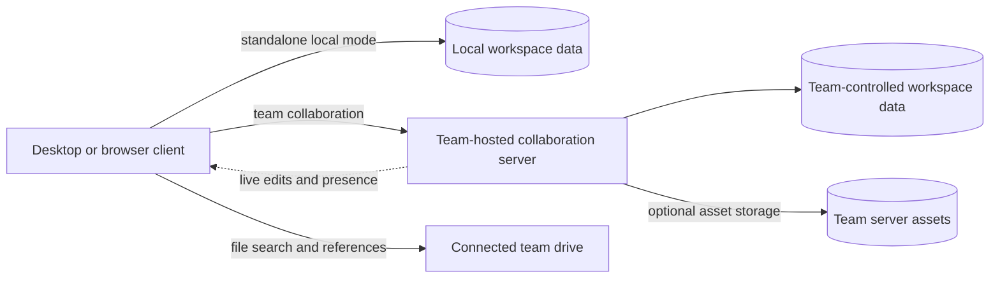
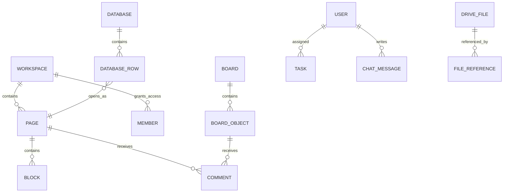

# Architect product direction

Architect is a private, team-owned workspace tool for documents, structured data, visual work, and team coordination. It should combine the flexibility of a document workspace with the shared presence and communication tools of a team app, while leaving hosting and storage under the team's control.

This document describes the intended product, not a claim that these capabilities already exist. See [`../Completed/ImplementedFeatures.md`](../Completed/ImplementedFeatures.md) for the current implementation and [`../WorkInProgress/TODO.md`](../WorkInProgress/TODO.md) for prioritized work.

## Product principles

1. **The team controls where it runs and where its data lives.** Multi-user live editing needs a collaboration server, but that server should be team-hosted or otherwise explicitly chosen by the team; Architect must not require a global Architect-hosted website or cloud service.
2. **One purchase, no subscription plans.** The intended commercial model is a single payment for the tool for a team. Do not design subscription tiers or plan-gated features. License delivery, upgrades, and any limits still need a product decision.
3. **One workspace for work.** Documents, databases, visual boards, tasks, discussions, calendar events, files, and permissions should be connected rather than scattered across separate products.
4. **Fast, direct editing.** Text pages should have a modern, keyboard-friendly toolbar and editing experience inspired by Obsidian, with clear controls and local-first responsiveness.
5. **Reference files instead of copying them.** Drive integration should let users find and attach references to existing files. Upload is available when needed, with clear ownership and storage behavior.
6. **People stay in control.** Remove AI chat surfaces and the marketplace from the product. Avoid AI-generated content flows and third-party app marketplace dependencies in the core interface.

## Hosting, data, and deployment

The user or team chooses between two workspace modes, with asset storage selected separately:

- **Local only:** run Architect on a computer, keeping workspace data on that device. This standalone mode does not provide live multi-user editing.
- **Team collaboration:** connect to a collaboration server. The first-class route is the team's own server, including one hosted on its website/domain. A future Architect-hosted server could be optional, but must not be the only way to collaborate.
- **Asset storage:** choose local files, a connected drive, or the collaboration server's configured asset store. A drive connection does not imply that Architect owns or copies all drive content.

Live collaboration requires a shared coordination point to authenticate members, persist revisions, broadcast presence/edits, and resolve concurrent changes. Architect should provide a self-hostable server component so teams can collaborate without an Architect-operated cloud. Standalone local use remains available for one user or one device at a time.

Deployment requirements:

- No mandatory Architect-operated website, identity service, file store, or collaboration cloud.
- A server is required for shared live editing; a self-hostable team server is the first-class route. Local-only mode remains independent and does not pretend to sync.
- Make the active mode, data location, and connected drives visible in settings.
- Design local-only use to work without an account on an Architect service.
- Team collaboration mode needs authentication, authorization, encrypted transport, backup/restore, and an upgrade path.
- Define how offline edits, server availability, conflicts, and local caches behave before implementing synchronization.
- Keep workspace content exportable in documented formats and provide a recovery path for server or local data.
- Treat drive integration as provider adapters with least-privilege access; preserve file IDs/URLs and provider metadata rather than silently duplicating files.

### Initial data contract

- **Local mode:** no sign-in to an Architect service. The current prototype stores the workspace in the browser/Electron profile; the new settings flow makes that location visible and supports portable JSON backup/restore. Treat this as prototype storage behind a future storage adapter, not the final desktop database design.
- **Portable format:** versioned JSON workspace backup with workspace metadata, stable content IDs, user records, page/block data, and references to locally uploaded assets. Import must validate the version and preserve the existing workspace if validation or storage fails.
- **Desktop target:** move the source of truth behind a storage adapter and into an app-owned local data directory. Keep export format independent of the internal database so local storage can evolve without breaking backups.
- **Collaboration server:** a workspace connects directly to its administrator-configured server URL. The server owns the authoritative workspace database, revisions, member sessions, and file metadata. The first API proposal is versioned JSON over HTTPS for reads/writes plus WebSocket events for live edits and presence; no requests route through an Architect-operated service.
- **Identity:** local-only mode may use a local profile. Team identity is administered by that server, with local accounts as the baseline and optional self-hosted identity-provider support. No Architect account is required.
- **Offline and conflicts:** local-only mode works offline by definition. In team mode, the server coordinates live edits and stores revisions. Queue offline edits with their base revision, then reconcile on reconnect. A conflicting edit must be shown for resolution; do not silently overwrite the server or local version.
- **Files:** references keep provider ID, provider, canonical URL, metadata, and access state. Uploads are stored in a user-selected drive or in the team's configured server storage. Large file bytes should not be embedded in workspace JSON once a durable asset store exists.
- **Recovery:** export a portable backup before destructive migration/restore. Server owners control scheduled backups and restore; desktop local data must remain exportable and recoverable without an Architect account.

## Page and workspace content types

Architect should support multiple purpose-built content types under one workspace. Each type has an appropriate editor, toolbar, permissions, and linkable identity.

| Type | Intended use | Core interactions |
| --- | --- | --- |
| Text page | Notes, specs, and long-form writing | Rich text, Markdown shortcuts, backlinks, embeds, comments, attachments |
| Database | Structured records and workflows | Properties, rows, views, filters, sorts, relations, automations |
| Board | Spatial planning, diagrams, and workshops (Miro-like) | Infinite canvas, movable objects, connectors, frames, comments, zoom |
| Task view | Personal and team work | Task status, assignee, due date, priority, project, list/board/calendar views |
| Calendar | Team schedule and time planning | Events, availability, task dates, participant permissions |
| Chat | Real-time team discussion | Direct chats, topic channels, groups, replies, mentions, attachments |
| Dashboard | User or team landing page | Configurable widgets for tasks, chats, calendar, time, and quick links |

Pages and records should have stable IDs, titles, owners, timestamps, permissions, and links. Database rows can open as pages and can be linked from text, tasks, boards, and chats. Board objects and comments should have stable IDs as well. The content model and migrations must support adding a new type without breaking existing pages.

### Shared model and permissions

- Give every workspace, member, page, block, database, schema property, row, board, board object, task, event, channel, message, comment, file reference, and automation a stable UUID. Keep display names separate from identity.
- Common metadata: `workspaceId`, `createdAt`, `updatedAt`, `createdBy`, `updatedBy`, and a monotonically increasing `revision`. Records that can be archived or deleted should have explicit lifecycle state instead of being silently discarded.
- A database row has its own ID and a linked page ID. Its values are keyed by shared schema property IDs. A schema migration must preserve unknown values and provide a reversible backup before changing stored data.
- Use versioned, ordered migrations (`fromVersion`, `toVersion`) for local data and server data. Migrations must be idempotent, validate before commit, and retain a restorable pre-migration backup.
- Workspace roles begin with **owner**, **admin**, **member**, and **guest**. Check access at the server boundary and in the UI. Page/database/board/channel permissions can narrow inherited workspace access; explicit grants and denies should be visible and auditable.
- Dashboard widgets, search, inbox, chat previews, and notifications must apply the same access checks as opening the underlying record. Never leak titles or snippets for inaccessible records.
- Keep an audit event for membership, role, permission, drive connection, and administrator announcement changes. Do not expose private direct messages or time details to admins unless the workspace policy explicitly grants that access.

## Text page editor and toolbar

Non-database pages should have a modern toolbar inspired by Obsidian. It should remain focused on writing and make common formatting available without requiring slash commands.

- Formatting: paragraph, heading levels, bold, italic, underline, strikethrough, inline code, code block, highlight, clear formatting.
- Structure: bulleted and numbered lists, checklists, quotes, callouts, dividers, tables, columns, collapsible sections, links, page references, and embeds.
- Insertion: image/file reference, board/database/task reference, date, and comment anchor.
- Editing: undo/redo, keyboard shortcuts, Markdown typing shortcuts, selection-aware actions, paste conversion, and accessible toolbar navigation.
- Presentation: compact and readable controls, visible active formatting, contextual selection toolbar, and configurable toolbar placement/visibility.
- Markdown: common Markdown input shortcuts and copy/export behavior should be predictable. Store semantic document nodes so formatting survives edits and export.

The toolbar is for text pages. Database and board pages should show controls that fit their own content type rather than forcing the text toolbar everywhere.

## Dashboards, tasks, calendar, and time

Each user has a customizable dashboard, with optional team dashboards. Widgets should be permission-aware and link back to their source records.

- **Task overview:** assigned to me, due soon, overdue, status, priority, and project filters; quick status and due-date edits.
- **Chats:** recent direct chats, topic channels, groups, unread counts, and mentions.
- **Calendar:** upcoming events and tasks, with configurable calendar sources and permissions.
- **Time tracker:** start/stop timer, manual entry, task/project association, and a reviewable time history. Define privacy and who can view team time before implementation.
- **Customization:** add, remove, resize, reorder, and configure widgets; save personal layout separately from shared team layouts.

Permissions should follow the underlying records. A dashboard must not expose a task, chat, or calendar item to a user who cannot access its source.

## Asset management and drive references

Provide a central asset manager for files users can access. It should work with connected drives and local uploads without turning into an opaque duplicate file store.

- Search files by name, type, owner, location, tags, and relevant provider metadata.
- Browse and filter by provider, folder, file type, and tag; show thumbnails/previews where supported.
- Attach a reference to a page, database row, board object, task, or chat. Preserve provider identity and open the original file.
- Upload a file when it does not already exist in a connected drive; make the destination and resulting reference explicit.
- Tag and rename files when the connected provider grants permission. Clearly report when a provider does not allow the operation.
- Support reusable references, rename conflict handling, deleted/moved file states, and refresh of provider metadata.
- Keep drive credentials secure and request only scopes needed for selected operations.

The asset manager must distinguish a **reference** from an **Architect-managed upload**. The UI should state where an upload is stored and who can access it.

## Image annotations and comments

Users should be able to mark a region of an image and attach a comment to that exact location, similar to Google Drive image comments.

- Create an image annotation by selecting or drawing a region, then writing a threaded comment.
- Show annotation markers and comment threads on the image; selecting a comment highlights its region and vice versa.
- Support replies, resolve/reopen, mentions, timestamps, and permission checks.
- Keep annotation coordinates stable as the image is zoomed or resized; define how they behave if the underlying image changes.
- Store annotations against the referenced file identity and version where available. For unsupported drive providers, offer a clear local annotation fallback without implying the source file was modified.
- Provide keyboard-accessible alternatives to drawing a region.

## Inbox

Replace a basic notification list with a configurable inbox that helps users triage work.

- Combine mentions, page comments, task assignments/updates, chat activity, approvals, and administrator announcements.
- Filter by source, workspace, unread/read, assigned to me, and date; search and sort the inbox.
- Allow mark read/unread, archive, snooze, mute source/thread, and bulk actions where permissions allow.
- Configure notification categories and delivery preferences without hiding security-critical messages.
- Group related activity into threads and link directly to the relevant page, block, image region, database row, task, or chat message.
- Keep global administrator announcements distinct and clearly labeled; users should be able to tell who sent them and whether action is required.

## Chat, groups, administration, and permissions

Provide team communication inspired by Discord while keeping conversation attached to workspace work.

- Direct messages, topic-based channels, and private groups.
- Threads/replies, mentions, reactions, attachments, search, unread state, and notification controls.
- Link chat messages to pages, tasks, database records, boards, calendar events, and files.
- Administrators can send important global announcements to the whole workspace; support acknowledgment or required-action state where appropriate.
- Admin dashboard for members, roles, invitations, workspace settings, connected drives, server health, retention, and audit history.
- Permissions for workspace, content type, page/record, channel/group, file reference, and administrative actions.
- Use explicit roles and access inheritance with clear exceptions, visible sharing state, and an audit trail for sensitive permission changes.
- Separate administrator-wide announcements from ordinary global chat. Define moderation, retention, search visibility, and who may create channels/groups.

## Databases, buttons, and automations

Databases should be shared collections with multiple views, not unrelated properties attached to individual pages.

- Shared schemas, typed properties, records that open as pages, relations, rollups, and reusable views.
- Table, list, board, calendar, and gallery views with filters, sorting, grouping, visible-property controls, and saved view settings.
- Buttons should support named actions such as creating a record/page, changing a property, assigning a person, setting a date, adding a comment, or opening a link.
- Automation triggers may include record creation/change, property condition, schedule, or an explicit button action.
- Automation actions must be permission-checked, previewable, traceable, and safe to retry. Show run history, failures, and the actor/automation responsible.
- Start with deterministic actions; define loops, duplicate triggers, rate limits, and rollback behavior before exposing automation chains.

## Explicitly excluded from the product

- AI chat or AI assistant surfaces.
- An app or integration marketplace.
- Subscription plans, tiered plans, or plan-gated product features.
- A mandatory global Architect cloud or Architect-operated workspace website.

These exclusions do not prevent connecting user-selected drives or servers. Integrations should be configured directly by workspace administrators, with clear scopes and ownership.

## Delivery sequence and dependencies

1. **Lock down the local-first foundation:** choose data format, local storage and export, migration strategy, and identity model that works without an Architect account.
2. **Define the shared workspace model:** workspaces, members, roles, pages, typed content, database schemas/rows, files/references, comments, and audit events.
3. **Complete the editor and page types:** robust text editing and Markdown, shared database/views, then the board canvas and object model.
4. **Add team collaboration:** custom server protocol, authentication, permissions, conflict handling, chat, inbox, and admin announcements.
5. **Add operational workflows:** dashboard widgets, tasks, calendar, time tracker, buttons, and auditable automations.
6. **Integrate assets:** drive adapters, reference lifecycle, upload flow, asset search/tags, then image-region comments.
7. **Package and commercialize:** local desktop builds, self-hosted deployment, upgrades/backups, and a single-payment team license model.

Do not start a dependent feature before its data ownership, permission model, and offline/server behavior are specified. Each delivered feature should update the implementation inventory, TODO, and release changelog as required by [`../AGENTS.md`](../AGENTS.md).

## Open product decisions

- Which server deployment formats and minimum server requirements are supported?
- Is the browser client self-hosted with the server, or can it connect to any compatible custom endpoint?
- What data is local-only, server-authoritative, or cached in team-hosted mode?
- Which drive providers are first, and what scopes do rename, tagging, upload, and comments require?
- Is the single payment per team perpetual for a version, and how are paid upgrades handled?
- Can teams use chat, calendar, and time tracking without enabling all three?
- Which administrator announcements require acknowledgment, and who can send them?
- Are image annotations stored only in Architect or written back to providers that support them?
- What is the retention and export policy for messages, activity, time records, and audit events?
