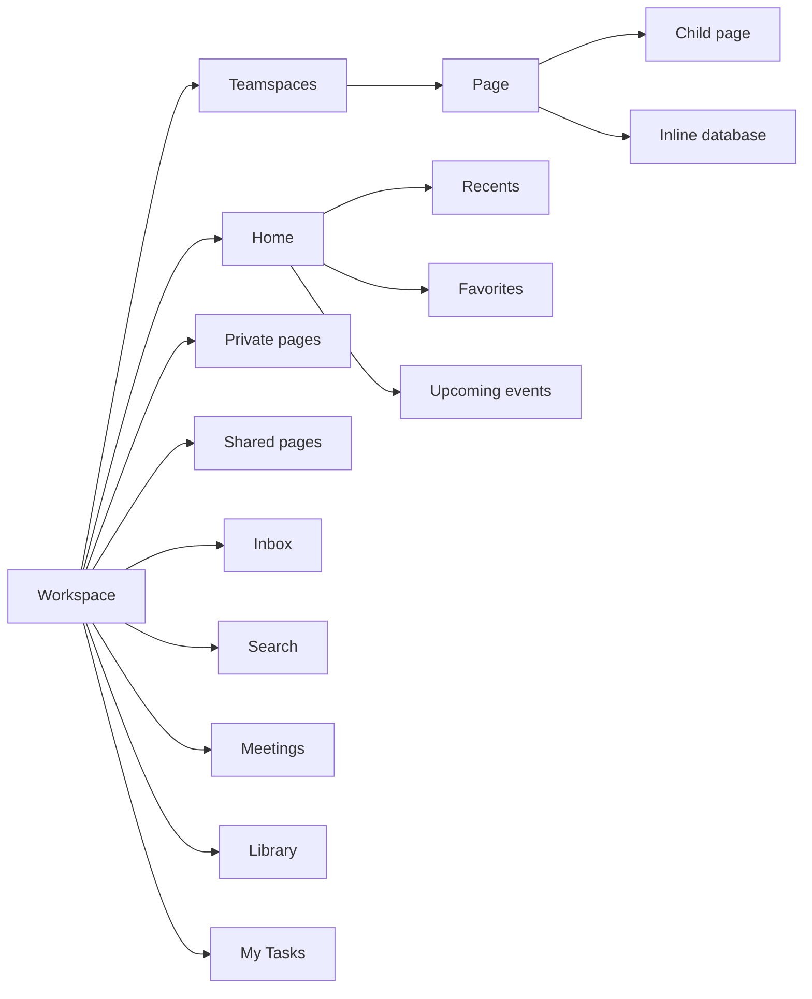
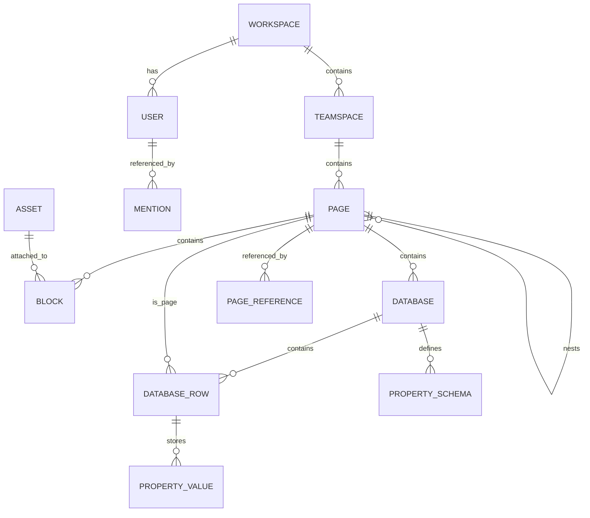
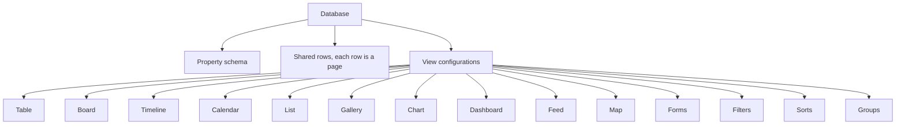

# Notion Clone: Product Structure and Implementation Plan

This document describes a product scope and implementation roadmap for a Notion-style workspace. It covers navigation, page and block content, slash commands, Markdown, mentions, databases, media, workspace surfaces, and acceptance checks.

## Research basis and limits

This outline combines Notion's published help documentation with a live, read-only REA inspection of the signed-in Notion desktop renderer through Chrome DevTools Protocol. The inspected page was a database row opened as a page. The capture exposed a sidebar, breadcrumb/header, Share and Copy link actions, Favorite and Actions controls, a page-properties table, Add a property, Add icon, Add cover, Customize layout, comments, and a database row with many typed property values. The observation reflects one workspace and one page, not every workspace configuration or plan. Exact UI and feature availability vary by workspace, plan, platform, and user settings.

The live database-page capture showed that a database row is page-like: it has a title and body context plus a large property table, metadata, and actions. The sidebar exposed teamspace/workspace navigation and Library entry points. The capture was passive; no user data was changed. REA returned a policy-filtered snapshot with attachment limitations, so it does not establish complete source, network, worker, or hidden-menu coverage. For full command inventories, use the official keyboard shortcut and block documentation linked below.

Primary references:

- [Notion keyboard shortcuts, Markdown, @ commands, and slash commands](https://www.notion.com/help/keyboard-shortcuts)
- [Using slash commands](https://www.notion.com/en-gb/help/guides/using-slash-commands)
- [Sidebar navigation](https://www.notion.com/help/navigate-with-the-sidebar)
- [Block types](https://www.notion.com/help/guides/types-of-content-blocks)
- [Database views, filters, sorts, and groups](https://www.notion.com/help/views-filters-and-sorts)
- [Database properties](https://www.notion.com/help/database-properties)
- [Create a database](https://www.notion.com/help/create-a-database)

## 1. Product areas and navigation

Notion's sidebar is customizable, so tabs and sections can differ between workspaces. The product areas documented in the current help center include:

| Area | Purpose and expected behaviors |
| --- | --- |
| Search | Search workspace content and jump to recent pages. `Ctrl/Cmd+K` opens search. |
| Home | Configurable overview of recents, favorites, teamspaces, shared/private pages, upcoming events, agents, and apps. |
| Workspace switcher | Switch workspaces or accounts, create a workspace, log out, and open workspace settings. |
| Teamspaces | Browse and organize shared workspace areas. |
| Inbox | Notifications for mentions, comments, page changes, assignments, and reminders; filters, archive, mark-read, and bulk actions. |
| Meetings | Upcoming events and meeting notes/history. |
| AI chats | Search and research conversations, when available. |
| Library | Browse/manage workspace content. |
| My Tasks | Task-focused view of work assigned to the user. |
| Templates | Create pages from starter content. |
| Marketplace | Browse templates and integrations. |
| Help | Help center and support entry points. |
| Trash | Recover or permanently remove deleted content. |
| Settings and members | Workspace settings, member management, and account preferences. |

The sidebar also supports nested pages, expandable page trees, page reordering, configurable sections, and configurable shortcuts. The app header should provide breadcrumbs and page-level actions. Database pages add their own view tabs and controls.

### Navigation and document graph

## 2. Content and element model

The editor should treat pages as documents made from ordered, typed blocks. Pages can contain child pages. Database rows are also pages and may contain their own blocks and nested pages.

### Element families

| Family | Elements |
| --- | --- |
| Text and structure | Text, H1/H2/H3, bulleted list, numbered list, to-do, toggle, quote, callout, divider, table of contents, breadcrumbs |
| Page and inline references | Child page, page link, person mention, page mention, date, reminder, emoji, equation |
| Layout | Columns, nested columns, toggle headings, nested blocks |
| Media and embeds | Image, file, PDF, video, audio, code, web bookmark, embed |
| Databases | Database page or inline database, rows as pages, properties, views, filters, sorts, groups |
| Advanced | Buttons/templates, formulas, linked database views, math/equations |

### Block data and operations

Each block should have:

- A stable block ID, page ID, type, order, and content.
- Type-specific data. Examples: checkbox state; target page ID; mention target ID; file/asset ID; code language; toggle children; column children; database ID.
- Formatting data that survives save/reload, selection, copy/paste, and editing.
- Operations: insert, edit, convert, duplicate, delete, reorder, indent, outdent, move to a page, and link.

Stable IDs are essential. Page links and mentions should reference IDs rather than store only titles, so links continue to work when titles change.

### Page-link acceptance behavior

Typing `/page` should insert a page-link block into the current page and create a child page with a stable page ID. The child should appear in the sidebar because of its parent relationship, but the sidebar entry must not be the only record of the new page. Clicking the inline link and clicking its sidebar entry must open the same page. Renaming that page must update the visible title in both places.

## 3. Slash command catalog

The slash menu should open when `/` is typed in an empty block. Additional typing filters the menu live. Arrow keys change selection; Tab or Enter applies the selected command; Escape closes the menu without inserting a command. The menu should be searchable and grouped by category.

Every menu item must perform its real action. A visible label that creates only a generic text block is not considered implemented.

### Basic commands

| Command | Expected result |
| --- | --- |
| `/text`, `/plain` | New text block |
| `/page` | New child page plus a clickable source-page link block |
| `/bullet` | Bulleted list item |
| `/num` | Numbered list item |
| `/todo` | Checkbox item with persisted checked state |
| `/toggle` | Expandable/collapsible block with child content |
| `/div` | Horizontal divider |
| `/quote` | Quote block |
| `/h1`, `/#` | Heading 1 |
| `/h2`, `/##` | Heading 2 |
| `/h3`, `/###` | Heading 3 |
| `/link` | Search existing workspace pages and insert a stable-ID page link |

### Inline commands

| Command | Expected result |
| --- | --- |
| `/mention` | Search users or pages and insert a structured inline mention |
| `/date`, `/reminder` | Date picker; reminder stores date/time and reminder state |
| `/equation` | Inline TeX equation editor and renderer |
| `/emoji` | Emoji picker; selected emoji is inserted inline |

### Media commands

| Command | Expected result |
| --- | --- |
| `/image` | Upload, choose an existing asset, or embed an image URL |
| `/pdf` | Attach a PDF or embed a PDF URL |
| `/book` | Create a web bookmark with URL, title, and preview metadata |
| `/video` | Upload or embed a supported video URL |
| `/audio` | Upload or embed an audio source |
| `/code` | Code block with language selection and copy action |
| `/file` | Upload a file or attach a URL |
| `/embed` | Embed a supported external URL |

### Advanced commands and block actions

| Command | Expected result |
| --- | --- |
| `/duplicate` | Duplicate the current block with its content and settings |
| `/moveto` | Choose a destination page and move the block |
| `/delete` | Delete the current block, with undo support |
| `/toc` | Table of contents generated from page headings |
| `/button`, `/template` | Configure a button that inserts a selected block/page template |
| `/bread` | Breadcrumb block for the current page hierarchy |
| `/math`, `/latex` | Display math block with TeX editing/rendering |
| `/turn…` | Convert the current block to another supported block type |
| `/red`, `/blue`, `/blue background`, `/default` | Apply text color or highlight color to the current block/selection |

The full menu should include other block types supported in the target clone, including columns, tables, and database creation. The exact categories and available options should be data-driven so each command has a typed implementation and acceptance test.

## 4. Markdown and keyboard editing

Separate line-start Markdown shortcuts from inline formatting.

### Line-start shortcuts

| Input | Result |
| --- | --- |
| `# `, `## `, `### ` | H1, H2, H3 |
| `* `, `- `, `+ ` | Bulleted list |
| `1. `, `a. `, `i. ` | Numbered list |
| `[] ` | To-do checkbox |
| `> ` | Toggle list |
| `" ` | Quote |
| `---` | Divider |

### Inline Markdown and selection shortcuts

- `**text**` → bold.
- `*text*` → italic.
- `` `text` `` → inline code.
- `~text~` → strikethrough.
- `Ctrl/Cmd+B`, `I`, `U`, `Shift+S`, and `E` apply formatting to selection.
- `Ctrl/Cmd+K` links selected text.
- Transformations must preserve the caret and selection and persist formatting across reloads.

### Additional editor shortcuts

- `Ctrl/Cmd+K` or `P` opens search.
- `Ctrl/Cmd+N` creates a page.
- `Ctrl/Cmd+F` searches inside a page.
- `Ctrl/Cmd+Enter` opens/toggles/modifies the focused block where applicable.
- `Tab` and `Shift+Tab` indent/outdent blocks.
- `Ctrl/Cmd+D` duplicates a selected block.
- `Ctrl/Cmd+Shift+1…9` applies block types, including text, headings, lists, code, and page.
- `Ctrl/Cmd+Shift+U` navigates to the parent page.

Shortcut behavior should be platform-aware for macOS and Windows, and must not steal browser/Electron text-editing shortcuts unexpectedly.

## 5. References, mentions, and inline page creation

### `@` mentions

- Show a live suggestion list for people, pages, dates, and reminders.
- Store type and target ID, not just visible text.
- Render page mentions as clickable links that navigate to the referenced page.
- Render people as structured mentions; notification delivery is a separate collaboration feature.
- Support Escape to dismiss suggestions and preserve a literal `@`.

### `[[` and `+` page commands

- `[[` prioritizes linking to an existing page.
- Offer “Add new sub-page” for creating a child page under the current page.
- Offer “Add new page in…” for selecting another parent page/database.
- `+` prioritizes creating a page, while still offering existing-page links.
- Page titles in references should update automatically when the target page is renamed.

## 6. Assets, covers, and embeds

### Asset library

- Store assets in an app-managed asset layer, not as large data URLs in localStorage.
- Track stable asset ID, original name, media type, size, dimensions, created time, and local file path/content reference.
- Filter the picker by image type for covers and icons.
- Support upload, preview, removal, and reuse across pages.

### Covers and icons

- Cover picker: existing image library, upload, and later external image providers.
- Crop preview must use the final cover aspect ratio and dimensions.
- Save crop position/scale and show it consistently in the page header.
- Show a low-opacity “Edit cover” button at the bottom-right on hover/interaction.
- Icon picker: emoji/icon catalog plus custom image upload; custom icon should render as an image in the sidebar and page title area.

### Media blocks

Build upload/URL flows, preview, retry/error handling, download/open, and appropriate renderers for images, files, PDFs, video, audio, bookmarks, code, and embeds. Enforce file type/size limits and keep persisted content independent from transient object URLs.

## 7. Databases

Every database row is a page with properties and a body. A database can have multiple views over the same row data.

### Property types

- Title, text, number
- Select, multi-select, status
- Date/date range, optional time and reminder
- Person
- Files and media
- URL, email, phone
- Checkbox
- Formula
- Relation and rollup
- Created time/by and last edited time/by

Property schemas and row values should be separate. Add property editing, validation, filtering/sorting, visibility, and per-view configuration.

### Database views

Current documented view catalog includes:

- Table
- Board/Kanban
- Timeline
- Calendar
- List
- Gallery
- Chart
- Dashboard
- Feed
- Map
- Forms

Views are configurations over shared database rows, not duplicate datasets. View settings include layout, property visibility, filters, sorts, groups/subgroups, open-page behavior, and view-specific options. Row cards/pages should open in side peek, center peek, or full-page mode as supported by the layout.

## 8. Workspace surfaces

- Home sections: upcoming events, recents, favorites, agents, teamspaces, shared pages, private pages, apps.
- Search: title/content search, recent pages, keyboard navigation, filters.
- Inbox: mentions, comments, changes, tasks, reminders; filter, archive, mark read, bulk actions.
- Meetings: upcoming events, meeting notes, history, links to calendar entries.
- Library: workspace content inventory and management.
- Templates: searchable starter content and page creation.
- Trash: restore/delete content.
- Settings: workspace/account preferences, members, access and sidebar configuration.
- My Tasks and related task surfaces.
- Optional AI chats, agents, and meeting-notes features depending on desired clone scope.

## 9. Phased implementation roadmap

### Phase 1 — Stable document model and navigation

1. Define typed workspace, page, block, user, asset, database, and property models.
2. Add stable IDs, parent/child page relations, and block ordering.
3. Render sidebar recursively from page relationships.
4. Add stable-ID page links and mentions.
5. Add persistence migrations for existing saved data.

**Acceptance checks:** Create inline child page; source-page link and sidebar entry persist on reload; renaming updates both references; both open the same page.

### Phase 2 — Editor and basic blocks

1. Build searchable slash picker with live filtering and keyboard navigation.
2. Implement text, headings, lists, to-dos, toggle, quote, callout, divider, columns, page links.
3. Add insert/edit/convert/duplicate/delete/reorder/indent/outdent/move operations.
4. Preserve selection/caret and support keyboard-only use.

**Acceptance checks:** Every basic command inserts correct type at cursor; editing and reload preserve content and order.

### Phase 3 — Markdown and inline references

1. Implement line-start shortcuts and inline formatting.
2. Add people/page/date/reminder suggestions with structured reference IDs.
3. Add `[[` and `+` menus for link-existing/create-child/create-under-parent flows.
4. Render inline references as semantic, clickable nodes.

**Acceptance checks:** Test every Markdown form; rename and reload page references; mentions retain IDs and render/click correctly.

### Phase 4 — Assets and media

1. Add local asset storage and metadata/index.
2. Implement image filtering, upload, preview, removal, and reuse.
3. Implement cover crop preview with saved crop state and custom page icons.
4. Add image/file/PDF/video/audio/code/bookmark/embed renderers.

**Acceptance checks:** Upload/reopen assets after app restart; crop persists; custom icon appears in sidebar; failures are recoverable.

### Phase 5 — Databases

1. Add database and row/page models.
2. Add property schemas and values for all listed types.
3. Implement Table first, then List, Board, Calendar, Gallery, Timeline, Chart, Dashboard, Feed, Map, Forms.
4. Add filters, sorts, grouping, property visibility, linked views, and peek/full-page modes.

**Acceptance checks:** Edit a row in one view and see the same values in other views; verify filtering, sorting, and persistence.

### Phase 6 — Workspace surfaces

1. Implement Home, Search, Inbox, My Tasks, Meetings, Library, Templates, Trash, settings.
2. Add configurable sidebar sections and shortcuts.
3. Add notifications, comments, reminders, and activity surfaces as selected for the clone.

**Acceptance checks:** Each navigation area opens the correct content; search finds page and block content; inbox navigates to source records.

### Phase 7 — Advanced parity and quality

1. Add advanced slash actions: move, turn, colors, table of contents, breadcrumbs, buttons/templates, equations.
2. Add sharing/access controls, comments, version history, import/export, offline support if in scope.
3. Add accessibility, responsive web/mobile behavior, and Windows/macOS packaging.
4. Run full acceptance suite on web, Windows, and macOS.

**Acceptance checks:** Every menu command has a command-specific test; keyboard-only, persistence, narrow layouts, and desktop packaging pass.

## 10. Test strategy

- **Unit tests:** typed block transformations, Markdown parsing, page-reference resolution, persistence migration, property value validation.
- **Component tests:** slash filtering, selection keys, dialogs, pickers, block renderers, database view settings.
- **Integration tests:** create inline page, rename, navigate, reload, and verify sidebar/source references; upload/crop/reopen assets; edit rows across views.
- **End-to-end tests:** command catalog interactions, keyboard navigation, search, Inbox links, mobile-width layouts, desktop launch.
- **Regression fixtures:** seed workspace plus historical persisted schemas and malformed/unavailable media references.

Do not mark a command “implemented” merely because it appears in the menu. Each command needs an asserted state change, rendered output, persistence behavior, and a test.

## 11. Current clone status

The clone now uses a versioned workspace/page/block model with migration from its prior localStorage shape. It supports nested pages, stable-ID page-link blocks, page/person mention records, slash filtering and keyboard selection, common text/list/toggle/code/table/media blocks, Markdown block starters, search, and local persistence. Browser-preview checks confirmed `/page` creates a child and leaves a clickable link in the source page; the link persisted after reload and opened the same child page. `## ` converts an empty text block to a heading; `>` creates a quote. Inline formatting converts `**bold**`, `*italic*`, `~~strike~~`, and backtick code syntax to persisted rich-text markup, and supports bold, italic, and underline keyboard shortcuts. Empty trailing text blocks remain editable after Backspace. Page mentions render with the same document-style link as created pages. The slash menu filters as the user types, is positioned by the active block, and supports keyboard selection. The sidebar groups Favorites, Shared, and Workspace Pages; child pages appear only after disclosure-arrow activation, and the workspace access entry sits at the bottom. A reviewer confirmed prefix text survives both `@` and `[[` selection. Table headers, cells, and added rows, the selected code language, and typed page properties survive reload after the save debounce completes. The TypeScript/Electron build passes. The page property editor currently supports text, status/select, date, number, person, URL, email, phone, checkbox, and files values. This remains a local prototype: it does not yet match the full Notion product. Shared database schemas, row/view relationships, filters and sorts, inline mention layout, robust asset storage and cover cropping, collaboration/permissions, command-specific behavior across the full catalog, and workspace surfaces still need implementation and systematic acceptance tests.

### Live REA observation notes

- Target: signed-in Notion desktop renderer exposed as `Chrome/156` / `Electron/45` at `app.notion.com`.
- Rechecked in the current continuation: REA at `127.0.0.1:9222` still lists three signed-in Notion page targets on `app.notion.com` (the observed database-row page, `/blank`, and `/quick-search`). The connection was left intact; no browser session or login state was changed.
- Page pattern observed: database row titled as a person, opened as a page, with a **Page properties** region, many property rows, title and icon actions, cover action, Share/Copy link, Favorite, Actions, Customize layout, and comments.
- The property rows included date, select/status, number/formula-like values, person, URL/email/phone, and files/media fields. This is a sampled real page; names and values are private workspace data and are intentionally omitted from this plan.
- The target capture was passive and policy-filtered. A second empty-page tab exposed only a loading/blank accessibility tree, so it was not used as evidence for editor controls.
- The clone's own browser preview showed the page-link block as a distinct clickable element and verified source-page persistence after a reload.
- Additional clone checks verified the `## ` heading shortcut and a live `@Alex` person suggestion selected with Enter. A person mention rendered and remained a typed mention block. These checks cover individual paths, not the full Markdown or slash-command catalog.
- Independent browser testing verified table edits and row insertion persist after reload, and code language selection persists after the debounced save.
- The page property editor was exercised by adding a Status field, changing it to “In progress,” and reloading; the value remained selected.
- Independent testing confirmed Status, Person, Date, Number, and URL fields all persist their values after reload.
- REA rechecked the existing signed-in Notion renderer without navigating or changing it. Its page-level editing and database-row context are compared with Architect in [NotionComparison](NotionComparison.md); this capture remained policy-filtered.
- In version 0.1.0, project maintenance documents moved under `project structure/`; the Notion reference and comparison are in `Targets/`, implemented features are in `Completed/ImplementedFeatures.md`, and future custom product targets are reserved in `ArchitectStructure.md`.
